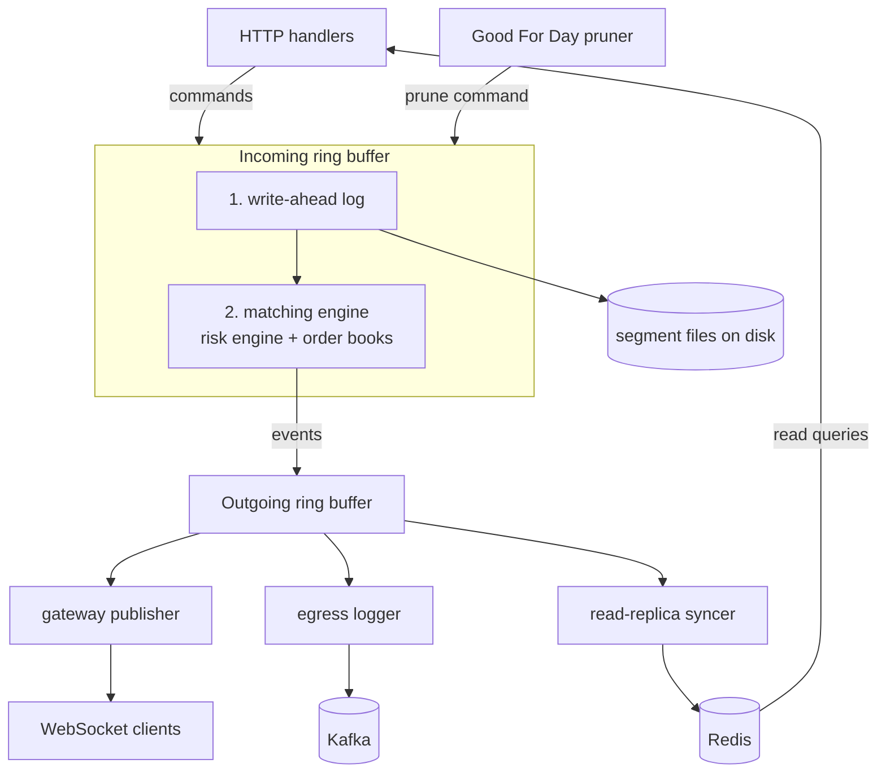

# 0007: Workers around the matching engine

- **Commits:** `53050b8`, `98f6dd5`, `8b0d8e3` → `04b1d11`
- **Status:** accepted. Recovery and snapshots are not built yet

## The problem

The matching engine was working. It takes a command, does the risk check, matches the order and emits events. But that is all it does, and that is all it should do.

A real exchange needs much more than that:

- If the process dies, the order book is gone, because it lives only in memory.
- Users want to see the trades and the order book changes live.
- Other services need to know what happened: the ledger, the settlement, the notifications.
- Users ask "what is the status of my order" far more often than they place orders.

All of these are slow things. Writing to disk is slow. Talking to Kafka is slow. Talking to Redis is slow. Sending data to a WebSocket client is slow. If the matching engine does any of this by itself, it has to wait, and the matching engine cannot wait.

## The decision

The matching engine does only the matching. Everything slow goes to a separate worker, and every worker runs on its own thread.

A worker never touches the order book. It only talks to the matching engine through a ring buffer. Either it reads events from the outgoing buffer, or it writes a command into the incoming buffer. So no worker can block the matching, and I do not need a single lock.

## Write-ahead log

The order book lives in memory. So I needed a record of everything the matching engine was told to do, in the exact order it was told.

Here I had to decide what to write: the commands coming in, or the events going out. I write the commands. The matching engine is deterministic. If I give it the same commands in the same order, I get the same order book. So the commands are enough to rebuild the state, and they are much smaller than the events.

The next question was when to write. If the matching engine matches an order first and the log is written later, then a crash in between loses a command that was already matched. So the log writer and the matching engine are two stages on the same incoming ring buffer, and the matching engine is chained behind the log writer. The matching engine can only see a command after the log writer is done with it.

For the file itself, I did not want a write system call for every command. So each log segment is a fixed-size file, created at full size and memory-mapped. Writing a command is just a copy into memory. Each record has a small header with the length, the sequence number, a timestamp and a checksum. When a segment is full, the writer closes it and opens the next one.

The flush is asynchronous. I ask the OS to flush at the end of every batch, and at least every 5 ms. If I waited for the disk on every command, the disk latency would come back into the matching path. The cost is this: if the process crashes, nothing is lost, because the data is already with the OS. But if the power goes, the last few milliseconds can be lost. I accepted that.

What is still wrong here: nothing reads the log back. There is no replay on startup. So right now the log is written but not used, and the checksum is written but never verified. The log is only half of the recovery story.

## Gateway publisher

Users want the live market data over WebSocket. But the matching engine is a plain thread and the WebSocket server is on the async runtime. Something has to carry the events from one side to the other.

So this worker reads the events from the outgoing ring buffer and sends them on a broadcast channel. The WebSocket side subscribes to that channel, serializes each event once, and sends the same bytes to every connected client.

I used a broadcast channel because of slow clients. If one client is slow, it must not slow down the others. With a broadcast channel, a client that falls too far behind just loses the old messages and continues. The matching engine never knows about it. For market data this is the correct behaviour. A stale client should skip ahead.

## Egress logger

The other services need to know what happened in the matching engine. The matching engine cannot call them, and they cannot read its memory.

So every event goes to Kafka. I use the symbol as the message key. That way all the events of one market go to the same partition and they stay in order. The order matters a lot here: a cancel must not arrive before the order it cancels.

I chose Kafka and not direct calls because Kafka keeps the events. If a service was down, it can catch up from where it stopped. And I can add a new service later without touching the matching engine.

The producer is configured for correctness first: idempotence is on and it waits for all the acknowledgements. This is the financial event stream, so I prefer a slower producer over a lost or duplicated event.

## Read-replica syncer

The read queries are far more frequent than the new orders. If every "get my order" request went to the matching engine, the reads would compete with the matching on the one thread that matters.

So this worker builds a copy of the state in Redis, only from the events. The orders, the price levels and the balances are all there. The read queries are answered from Redis and the matching engine handles only the writes.

The updates are batched. The worker collects the Redis commands in a pipeline and sends them together every 5 ms or every 100 operations. One round trip carries many updates.

The cost is that this copy is slightly behind. It can be a few milliseconds late. That is fine for showing the status of an order. It is not fine for deciding whether an order is allowed. This is exactly why the risk check lives inside the matching engine and does not read from here (see [0006](0006-risk-engine-inside-the-matching-engine.md)).

It is not complete. The mapping between internal and external user ids is not wired, a partly filled order is always written back as Good Till Cancel, and the worker does not stop when the ring buffer shuts down.

## Good For Day pruner

This one is from before (see [0003](0003-single-threaded-order-book.md) and [0004](0004-channels-and-the-exchange.md)). Earlier this thread took a lock on the order book. Now it sleeps until the end of the day and sends a prune command into the incoming buffer, like any HTTP handler would.

So the prune is written to the log like every other command, it runs on the matching engine thread in order with everything else, and there is no lock.

## Snapshot worker

This is not built. The file is only a stub.

I know why I need it. Replaying the log from the very first command gets slower every day the exchange runs. A snapshot is a saved copy of the order book at a known sequence number. Then recovery is: load the latest snapshot and replay only the commands after it.

The plan is to count the sequence numbers on the outgoing buffer, and after every N events send a snapshot command through the incoming buffer. Then the matching engine captures its own state at an exact point in the command order, and again no lock is needed.

## What I learned

- Every consumer has its own position in the ring buffer. A slow Kafka does not delay the WebSocket clients, and a slow Redis does not delay Kafka.
- But the buffer has a fixed size. If one consumer falls behind by the whole buffer, the matching engine cannot publish. It does not block, it drops the event. So the workers being separate does not mean they can be slow forever. This is a gap I still have to close.
- Sending a command is better than sharing memory. The pruner and the snapshot plan both work this way, and both need no lock because of it.
- A write-ahead log without replay is not durability yet. I wrote the hard part first and the part that makes it useful is still missing.

The byte layout of the log and the Redis keys are in the [workers README](../../rust/matching-engine/workers/README.md).

## Commit map

| Commit | What |
|---|---|
| `53050b8` | First logger with a consumer and producer for order book events |
| `98f6dd5` | WebSocket handling and the order book event consumer |
| `8b0d8e3`, `ea4dfe4` | Read replica support in the cache, Redis config for the replica |
| `134e090` | Write-ahead log worker and the gated ring buffer pipeline |
| `609fec4` | Read-replica syncer and event logger |
| `b13e6a0` | Pruner sends commands through the command dispatcher |
| `04b1d11` | Kafka producer for the egress logger |
